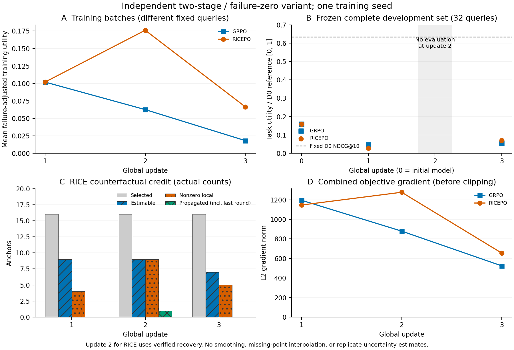

# 连续三更新与检索退化结果

两种方法均从各自已验证第一更新检查点建立独立child-run，继续更新2/3。Actor、优化器及CPU/CUDA RNG实际恢复；没有重跑已提交step。RICE更新2使用有证据约束的原生动作恢复，更新3重新在线生成。两种方法三个step均有非零奖励优势、非零梯度和真实权重变化；最终检查点在独立进程恢复到step3。

这是DeepSeek1.5B + Biology、单种子、四查询/更新的独立两阶段/失败零效用变体，不是论文完整性能复现。三个更新实际使用12个不同的冻结训练查询，两种方法查询日程一致。每次保留16原轨迹，RICE另有16锚点、80新分支；非法终止保留，最多五轮，并非全部轨迹合法完成五轮。

| 完整32题开发 | 合法五轮 | 失败调整任务分数 | last-valid真实NDCG均值 | 合法完成的真实最终NDCG | 同一合法子集D0 |
|---|---:|---:|---:|---:|---:|
| Initial | 14/32 | 0.159289 | 0.327628 | 0.364090 | 0.641635 |
| GRPO update1 | 15/32 | 0.047096 | 0.236521 | 0.100471 | 0.666488 |
| RICEPO update1 | 13/32 | 0.027714 | 0.184679 | 0.068219 | 0.706296 |
| GRPO update3 | 13/32 | 0.055125 | 0.248497 | 0.135693 | 0.630294 |
| RICEPO update3 | 13/32 | 0.070683 | 0.246248 | 0.173989 | 0.750912 |

全32题D0始终为0.634323。失败任务效用0不是检索NDCG=0；条件均值不能替代完整基准。没有update2开发扫描，不填零、不插值。第三更新RICE比GRPO高0.015558，但二者仍低于Initial；单种子小样本不支持论文优越性或局部信用的性能因果结论。

| 方法/更新 | 合法原轨迹/16 | 原奖励均值 | 非零轨迹优势/16 | Policy loss | KL（序列token和再均值） | 裁剪前梯度范数 |
|---|---:|---:|---:|---:|---:|---:|
| GRPO 1 | 7 | 0.101933 | 8 | -56.038944 | 0.000000 | 1195.313721 |
| GRPO 2 | 5 | 0.062500 | 4 | -25.062388 | 0.191907 | 879.628784 |
| GRPO 3 | 6 | 0.018067 | 4 | 89.200514 | 0.659390 | 523.916809 |
| RICEPO 1 | 7 | 0.101933 | 8 | -58.450356 | 0.000000 | 1146.472290 |
| RICEPO 2 | 6 | 0.176096 | 12 | -123.302658 | 0.246437 | 1277.078247 |
| RICEPO 3 | 8 | 0.066350 | 4 | -113.414825 | 0.428889 | 654.445129 |

每一行实际1次optimizer.step，固定参考不更新；均记录全state变化与参数探针变化。全局归约为16条序列、每条token损失求和后均值；不同批次查询不同，loss或训练奖励曲线不构成等难度性能序列。当前actor误差范围内更新前ratio接近1，clip fraction均0，属于单次参考更新的正常现象。后续更新的梯度包含policy与KL，未重新做每次局部信用的独立梯度消融。第一更新同原始IDs的受控梯度比较保留在此前证据中。

| RICE更新 | 可估计/选中 | 非零局部优势 | Summary实际改变token | 占原动作token | Think传播token | 推理门控通过 |
|---|---:|---:|---:|---:|---:|---:|
| 1 | 9/16 | 4 | 1070 | 4.15% | 0 | 0 |
| 2 | 9/16 | 9 | 1101 | 4.18% | 257 | 1 |
| 3 | 7/16 | 5 | 313 | 1.41% | 0 | 0 |

局部信用连续三个更新均实际使用，不是全部退化为GRPO。推理传播总共只通过1次，且在depth5：六结果局部奖励[1,1,0.3562071871,1,1,1]，总体方差0.0575651647，残差方差按定义为0；原始局部优势0.1072988021替换轨迹优势1.7320507676。它不是非末轮未来稳定性证据。未出现非末轮传播，阈值未降低。

可估计锚点中，影响门控失败计数依次8/9、3/9、5/7；残差门控失败2/9、5/9、2/7，两项可以重叠。更新2更多受残差约束，更新3更多受局部影响不足约束。缺失局部奖励的7、7、9个锚点独立标记not_estimable，整锚fallback到轨迹优势，不从成功分支重算分母。六结果总体方差、原分支恰一次、center_only、Summary替换/Thinkfallback及环境位置零优势已由CPU174831逐条重算。具体方差分布与局部/最终奖励在EVIDENCE。

退化分析表明格式失败与真实排名下降共同存在。首轮合法Summary检索就经常低于匹配D0；部分合法五轮轨迹中间命中优于最后一轮。原问题在原生上下文中，检索端确实采用冻结summary_only。重复低收益查询和主题漂移有具体私有案例，但随机策略路径差异不能直接解释为信用机制因果效应。详见[逐题逐轮报告](RETRIEVAL_AUDIT.md)。

高吞吐方面，完整HF采样工作量43.31→47.58 token/s，约1.10倍。另经实际验证，vLLM + CUDA Graphs + IEEE FP32在相同16请求/6734原生token上155.78→23.30秒，生成阶段约6.69倍；64并发853.12 token/s。IEEE80/80完整条件历史概率通过，同16请求与HF的原生IDs、种子、前缀均一致。默认TF32的更快候选3/80超门限，明确拒绝用于训练。详见[VLLM状态与配置](VLLM_STATUS.md)；本次三更新仍串行，vLLM尚未完成两阶段/4096预算/更新权重接入。

本阶段实际GPU用量10.128611小时，累计20.920278小时；按用户后续指令取消32小时停止上限，仍最多4GPU。四卡曾同时获配给两组双卡及后续2+1+1任务；没有四rank程序。所有本轮GPU任务已终止。原失败、重放、初始化、开发评估及独立重载都计入实际allocation；部分旧失败生成token只可给下界。

审核入口：[数值与哈希证据](EVIDENCE.json) · [真实测试/失败](TEST_RESULTS.md) · [数据](DATA_AUDIT.md) · [环境](ENVIRONMENT.md) · [续训](RUNTIME.md) · [恢复缺口](RECOVERY.md) · [修改表](CHANGES.md) · [规模依据](SCALE_NOTES.md) · [未完成事项](OPEN_ISSUES.md)。源码/模板/测试/报告公开，原始查询、完整轨迹、权重、检查点、原日志保留私有。公开模板继续禁执行；只更新PR2，不合并、不自动启动论文规模训练。

曲线：一个种子；训练查询随固定批次变化；开发只画实际0/1/3更新点；RICE更新2为恢复实验。精确绘图输入、变换、软件和文件SHA见CURVE_DATA.json/CURVE_PROVENANCE.json。
